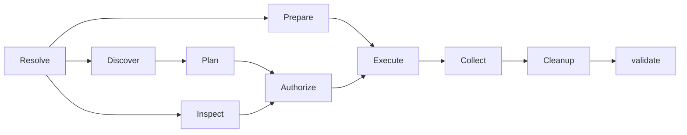

# CI implementation

Template owns grouped event workflows (push, pull, manual and remote), each dispatching the independent controller generated by CI-Engine. The generated controller pins the same engine action revision throughout and owns no consumer execution logic. There is one entry point and one final required check:



Prepare, Discover, and Inspect can start concurrently. Authorize waits for both Plan and Inspect; Execute waits for Prepare and Authorize. Optional host-test jobs run only when declared by the selected operation. The chosen execution mode is handled **inside** Execute. Each job has its own GitHub runner: Prepare checks workspace readiness but does not install tools into Execute's runner; component-owned setup runs where its tools are needed. Host tests and explicitly authorized publication use separate jobs within the engine's own graph.

config/ci/operations.json defines event routes, discoverable component contracts and trusted execution adapters. Read-only checks (setup, code review, rules audit, workflow lint, Build/tests and Template version checks) run in the engine with read-only permissions and no publication secrets. Project-owned JSON component manifests live in .github/components/.

Generated-workflow compilation and project-specific native adapter logic are owned by the managed CI-Engine native adapter. The canonical catalog is config/ci/operations.json.

Publication jobs use individual protected environments and explicit named credential bindings selected by the engine plan. Build and tests receive no publication credentials. Manual publication requires publish=true. Trusted preview publication uses a separate admitted artifact-only delivery path.

After adding a credential binding or changing the engine pin, regenerate the controller with `node dependencies/packages/core/dependencyLoader/index.ts --exec tools.ciEngine sync-workflow`. The engine's `sync-workflow --check` verifies the exact generated controller. Update the Actions lockfile using the existing lock tool before merging. Keep the full immutable engine revision; no secret values belong in the generated workflow.

## VS Code setup

Install the recommended [Workbench Bridge](https://marketplace.visualstudio.com/items?itemName=Kooraseru.workbench-bridge) extension when working in VS Code. The trusted workspace command starts `dependencies/packages/editor/editorIntegration/client.cjs`, which runs dependency setup and native preflight checks through the bridge. Setup progress, failures, checker findings, and reruns appear in the workspace status bar, output channel, and Problems panel. The same loader and checker remain available directly from the command line.

## Local CI and GitHub stages

Run the complete contributor validation path with one command from the repository root:

```sh
node dependencies/packages/core/dependencyLoader/index.ts --exec tools.ciEngine native-validate
```

Run the normal unprivileged contributor path with `node dependencies/packages/core/dependencyLoader/index.ts --exec tools.ciEngine native-validate`. It installs dependencies, executes the read-only Build component graph, then runs the repository test suites. Hosted review invokes these same checks and headless Preflight/Rules through the declared read-only route.

A trusted staged operation selects publication lanes from the component plan. Build and Tests must succeed before publication jobs receive narrowly scoped credentials.

Local `act` runs the same read-only engine graph, exporting verified native build bundles. Hosted Windows tests and all publication are omitted locally.

## Dependencies and local checks

`dependencies/dependencies.json` declares dependency sources and output locations; `dependencies/dependencies.lock` pins upstream versions, release assets, and the npm tree. Checked-in local tools live under `dependencies/packages/`, including `dependencyLoader`, `dataFormats`, and `ruleLinter`.

Install or refresh all declared dependencies and generate the local config discovery bridges with:

```sh
node dependencies/packages/core/dependencyLoader/index.ts
```

After changing dependency versions or sources in the manifest, refresh the lock and run setup again:

```sh
node dependencies/packages/core/dependencyLoader/index.ts --update-lock
node dependencies/packages/core/dependencyLoader/index.ts
```

Run a command through the loader so its dependencies are available first:

```sh
node dependencies/packages/core/dependencyLoader/index.ts --exec luau.lute --version
node dependencies/packages/core/dependencyLoader/index.ts --exec luau.lute check <managed CI-Engine>/src/native/entry.luau
node dependencies/packages/core/dependencyLoader/index.ts --exec luau.lute lint ci
```

The loader writes managed package/runtime files to `dependencies/managed/packages/`, executables to `dependencies/managed/bin/`, and generated type definitions to `dependencies/managed/types/`. These managed installations are ignored and survive deletion of `build/`. The npm provider writes its manifest, native lock, and install to dependencies/managed/npm/. See the [dependency provider contract](../dependencies/README.md). Local source packages stay checked in under `dependencies/packages/`.

## Configuration

Edit the canonical Luau config at `.vscode/config/luau/.luaurc` and the canonical TypeScript config at `.vscode/config/typescript/tsconfig.json`. Dependency setup generates root `.luaurc` and `tsconfig.json` discovery bridges for command line tools and editors. Those root bridges are ignored and hidden from Explorer; change the canonical configs instead. TypeScript includes `.ts`, `.tsx`, `.mts`, and `.cts` files across the repository, with generated output and external packages excluded. Luau strict checking is enabled in the canonical config, and TypeScript strict checking is enabled in its canonical `tsconfig.json`.

## Workflow Preflight

From the repository root, install the managed tools and the pinned Preflight package:

```powershell
node dependencies/packages/core/dependencyLoader/index.ts
```

Analyze the actual Bootstrap graph for an event:

```powershell
node dependencies/managed/npm/node_modules/preflight/bin/preflight.js plan --provider dependencies/packages/checks/preflightChecker/bootstrap/provider.cjs --entry pull_request
```

For a release plan, use `--entry push --target distribution/releases/publish`. Preflight includes the selected task's upstream dependencies. Plan analysis resolves the graph without running its tasks.

To show the pull-request plan in VS Code, add this command to the workspace's `workbenchBridge.workspaceCommands` after installing the package:

```json
["node", "dependencies/managed/npm/node_modules/preflight/bin/preflight.js", "workspace", "--provider", "dependencies/packages/checks/preflightChecker/bootstrap/provider.cjs", "--bridge-client", "dependencies/packages/editor/workbenchBridgeClient"]
```

Template owns editor workflow settings in `.vscode/config/workflow.json`. Each command is an argument array with an executable followed by its arguments. The same file controls status labels, the dependency progress notification, and which paths trigger a rerun. Reload the VS Code window after changing this configuration.

Automatic editor reruns happen after content changes are saved in watched source paths. The editor also watches on-disk changes to Luau sources and rule files, including edits made by other tools. Opening a file does not trigger either check. With rules.autoRefresh set to true in workflow.json, changes to active rules or their policy rerun Rules and rediscover validators automatically. Set it to false to get the **Refresh Rules** prompt. Reload the VS Code window after changing the setting. Rule examples are excluded. Saved fixture edits refresh fixture diagnostics separately from the workspace result. Run the fixture suites directly to verify the full acceptance matrices.

Click **Providers ready** to rerun dependency setup and reload Luau LSP. **CI Preflight** runs the compile checks and resolves the Bootstrap plans for pull requests, pushes, and manual dispatches. Plan mode does not execute the workflows. Rule violations appear in Problems.

From the workspace root, run `node dependencies/packages/editor/editorIntegration/client.cjs --problems` to read the open VS Code window’s current workspace diagnostics as JSON through Workbench Bridge. The snapshot includes diagnostics already published by Preflight, Rules, language servers, and other extensions.

The workspace host runs Luau LSP analysis at startup and after watched Luau changes on disk. Its findings appear as **Luau LSP workspace** in Problems, independently of the Preflight and Rules status labels. Analysis includes rule fixtures. Even fixtures expected to trigger a repository rule must pass Luau type checking. The host uses the configured executable, the installed extension's binary, or a command on PATH.

Workspace analysis invokes the same Luau LSP executable as the extension with its effective analyzer settings and base Luau configuration. When native Luau diagnostics arrive, they take precedence over matching workspace analysis and Lute findings at the same location. The workspace finding returns if the native diagnostic is withdrawn.

Rule diagnostics carry full spans and link to the owning rule. Expected fixture findings use the **Rule fixture** source in Problems and default to warning. They do not count against either status. Rules reports lint violations and fixture regressions. Preflight reports TypeScript and Luau compile-check results. Saving a fixture refreshes rule results.

JSON extraction is opt-in. In workflow.json, set checks.jsonExtractionLoaders to an array of objects with path (workspace glob), runtime ("lute"), returnContract ("json-object"), and expression (a project-owned Luau expression with one {file} placeholder). Preflight replaces the placeholder with the quoted sibling filename. The expression must load relative to the module and return the same validated shape. The default has no extraction loaders.

### Rules severity

See the [Rules settings contract](../rules/general/workflows/review/checker-contract.md) for discovered IDs, rule settings, and severity overrides. Run the dependency loader with --update-lock after changing a dependency declaration.

## Local GitHub Actions

From the repository root, run `node dependencies/packages/core/dependencyLoader/index.ts --only tools.ciEngine --exec tools.ciEngine` or use the **Run GitHub Actions locally** VS Code task.


## Local execution

Run normal dependency setup, then use the **CI: Run locally** task or GitHub Local Actions workflow button. The extension's supported `actCommand` setting routes through the same repository launcher. `act` must be on PATH. Informational flags (`--help`, `--version`, `--list`) pass through without starting a pipeline.

```sh
node dependencies/packages/core/dependencyLoader/index.ts
node dependencies/packages/core/dependencyLoader/index.ts --only tools.ciEngine --exec tools.ciEngine
node dependencies/packages/core/dependencyLoader/index.ts --only tools.ciEngine --exec tools.ciEngine --input operation=build
node dependencies/packages/core/dependencyLoader/index.ts --only tools.ciEngine --exec tools.ciEngine --input operation=readiness
```

Local `act` stages default to a 30-minute timeout, adjustable with `CI_LOCAL_TIMEOUT_MINUTES` (1–240). The launcher allocates a run-specific artifact server path and port, so do not pin either in `.actrc`. Failed runs preserve their stage logs under `build/run/<id>/` and invocation records in `.workspace/ci/runs/`.

Manual dispatch defaults to read-only `validation`. Source-push validation cannot publish and never exposes deployment permissions to generated build jobs. Source pushes, feature pushes and pull requests remain read-only. Publication is explicitly requested. The generated graph builds and tests, then publishes enabled targets through components. The `main` publication target is currently disabled; when enabled it creates a rootless orphan branch, while production Starlight Pages remains enabled. Publication uses a trusted default-branch workflow and independent job permissions. Attestation signing remains disabled.

The sample release and package conflict policies default to `skip`, not `replace`. To replace a tag, release, or package version, opt in explicitly after reviewing the generated outputs. Publication rehearsals route GitHub API requests and release-asset uploads to the local test server. The Pages site is built with Starlight from `content/docs/` and `content/images/` and deployed by its same-run native Publish component when GitHub Pages is configured for GitHub Actions. Attestation signing remains unimplemented and disabled.

The default is `workflow_dispatch` with `operation=validation`. Explicit events, `--input operation=...`, dotenv input files, and event payloads are honored. Local Build runs the same read-only controller and exports verified ordinary files. Publish is unavailable locally.

Current compiled outputs live under `build/artifacts/`; generated products stay under `build/github/`. Each invocation retains its own `build/run/<id>/outputs/` snapshot, Start and execution logs, stage reports, generated workflows, and internal transport archives. The previous successful current outputs remain intact after a failed run or export. Unowned or user-modified files cause an ownership conflict instead of being overwritten. The output manifest records paths, sizes, hashes, source revision, and the tracked working-copy digest.

Current-output ownership and v2 pipeline records live under ignored `.workspace/ci/`. Old v1 invocation records remain readable. Do not delete `.workspace/` as build cleanup. Archives are transport state; consumers inspect or launch the exported files directly.

## Headless code review

Pull requests into the default branch run the configured `review` operation through the external engine without opening an editor or exposing publication credentials. Rules Audit is a separate discovered component in the read-only engine, not a second permanent YAML. The engine's read-only execution job installs dependencies once through its discovered setup component and retains the Code Review and Rules Audit artifact outputs. Code Review runs Preflight (`--ci`) and Build/tests; Rules Audit independently runs repository Rules (`--rules`). Each publishes its own GitHub annotations and summary. This does not include VS Code-only or extension-provided diagnostics unless a separate headless analyzer is configured.

The external engine's read-only job uploads Code Review diagnostics as `code-review-findings/diagnostics.json` plus `summary.md`; Rules Audit produces its own `rules-audit-findings` artifact. To avoid flooding review pages with existing warnings, only the first 50 findings affecting PR-changed files are annotated; the full report retains the rest. Errors in changed files or checker failures block the relevant check; pre-existing errors in unrelated files are reported without blocking an unrelated pull request. Rules Audit excludes expected invalid rule-fixture findings, while unexpected fixture outcomes remain errors. A manual workflow dispatch reviews the whole repository.

Run `node dependencies/packages/core/dependencyLoader/index.ts`, then `node .github/components/quality/code-review/review.cjs` and `node .github/components/quality/rules-audit/audit.cjs` to audit both locally. The reports are written to `build/code-review/` and `build/rules-audit/`. Manual dispatch with `operation=rules-audit` executes only the rules job.


## Local act compatibility

The installed engine stages a temporary copy of its own workflows and action sources; the authored bootstrap pin is preserved, and compatibility-only artifacts remain in the disposable checkout.


## Native validation

The native test inventory is `.github/components/quality/workflows/hosts.cjs`, discovered from tracked host contracts. Build and universal tests execute once in the engine. A same-run native host matrix consumes the built executables. Collect and the required check wait for all host tests. Neither validation nor PR review creates a generated workflow branch.

