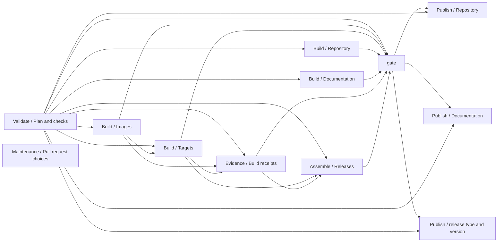

# CI ownership and execution

`.github/workflows/ci.yml` is the only orchestrator. Job IDs, dependencies,
conditions, permissions, output wiring, environments and concurrency are unchanged
by this refactor. Independent generation remains parallel.



Edges represent declared `needs`, including optional prerequisites. Existing
conditions permit skipped optional images and receipts where policy allows.
Maintenance remains independent and opt-in.

## Action audit and mapping

All old action paths below are relative to `.github/actions/`.

| Previous action | Classification | Result and implementation |
| --- | --- | --- |
| `run-luau/action.yml` | Generic execution adapter | Retained; calls `.github/integration/run.sh` |
| `setup-lune/action.yml` | Generic environment utility | Retained; verified runtime installation |
| `setup-github/action.yml` | Generic environment utility | Retained; GitHub CLI installation |
| `setup-native/action.yml` | Reusable bootstrap operation | Retained; resolves toolchain, installs Rust and builds native helpers |
| `setup-rust/action.yml` | Generic environment utility | Retained; native Rust setup |
| `setup-cmake/action.yml` | Generic environment utility | Retained; pinned CMake setup |
| `validate/action.yml` | Redundant forwarding wrapper | Removed; workflow uses `run-luau` with `validation/run` |
| `build/action.yml` | Redundant forwarding wrapper | Removed; workflow uses `run-luau` with `fabricator/workflow` |
| `package/action.yml` | Redundant forwarding wrapper | Removed; workflow uses `run-luau` with `fabricator/distribution/package` |
| `build-repo/action.yml` | Redundant forwarding wrapper | Removed; workflow uses `run-luau` with `publication/repo/build` |
| `gate/action.yml` | Redundant forwarding wrapper | Removed; workflow uses `run-luau` with `.github/integration/gate` |
| `build-pages/action.yml` | Domain adapter | Replaced by `publication/pages/action.yml`, owning the existing Pandoc installation and generation steps |
| `publish/action.yml` | Redundant domain dispatcher | Removed; existing named workflow steps directly invoke `publication/repo/publish.sh` and `publication/releases/publish.sh` |

All seven removed or replaced wrappers had no declared outputs. The forwarding
wrappers had no inputs; the removed publication dispatcher accepted only `output`
(`repository` or `release`). Their sole callers were workflow steps, now updated.

The retained interfaces and their dependency chains are:

| Action | Inputs | Dependencies and consumers |
| --- | --- | --- |
| `run-luau` | Required `module` | Bash, installed Lune, integration runner; used by workflow, Pages and native setup |
| `setup-lune` | None | Runner platform, checksum-pinned downloads, archive tools; used by workflow jobs |
| `setup-github` | None | Existing `gh` or Linux apt/sudo; used by workflow jobs |
| `setup-native` | None | Native configuration resolution, `setup-rust`, `run-luau`, `libraries/bootstrap/native`; used by trusted helper consumers in workflow |
| `setup-rust` | Required `toolchain` | `dtolnay/rust-toolchain`; used by workflow targets and native setup |
| `setup-cmake` | Required `version` | `actions/setup-python` and pip; used by configured native CMake targets |
| `publication/pages` | None | Existing apt/sudo Pandoc installation, Lune and `run-luau`; used by documentation job |

None declares action outputs. Native setup deliberately resolves its private
`definition` step outputs through a direct shell invocation before Rust setup;
this avoids depending on nested action output propagation. Workflow planning and
authority steps retain their original direct output-producing invocations.

The Pages adapter still uses `.github/actions/run-luau`. All module paths,
conditional steps, environment variables and step IDs retain their previous
meaning. No implementation modules move. Workflow validation recursively checks
reachable local actions, including colocated actions, and still checks every
generic action. The obsolete setup-node ordering rule is removed.

```text
.github/
  workflows/ci.yml
  actions/
    run-luau/action.yml
    setup-cmake/action.yml
    setup-github/action.yml
    setup-lune/action.yml
    setup-native/action.yml
    setup-rust/action.yml
  integration/                 # Existing GitHub and editor adapters remain
fabricator/
  workflow.luau
  distribution/package.luau
publication/
  pages/
    action.yml
    build.luau
    templates/...
  repo/
    build.luau
    publish.sh
    templates/...
  releases/
    plan.luau
    build.luau
    publish.sh
    ...
validation/
  run.luau
  workflows.luau
  gate.luau
  tests/...
security/
  access/...
  receipts/...
libraries/...
```

This shows affected interfaces, not a replacement inventory of unchanged files.

## Integration review and security boundaries

Dispatch, request and config translate GitHub events and manual inputs. Source
approval resolves GitHub actors, PR relationships and push payloads. Pending
receipts bind originating workflow runs to evidence. Refresh-PR updates the
GitHub manual form. Editor configuration, the extension bridge and local-actions
client integrate the local editor. These responsibilities remain in integration.

The integration gate aggregates GitHub job outcomes, controls and trusted evidence;
`validation/gate.luau` validates rule data. They serve distinct interfaces. Receipt
verification remains in security, and publication shell entry points retain their
hosted-context and source-protection enforcement. Removing a wrapper does not
remove any authorization check or expose publication credentials to build jobs.

Administrator source writes retain their authority to modify development source.
Every authorized source execution still requires normal validation and evidence
before downstream promotion. Failure blocks promotion without rollback or a
second administrator acceptance. Local execution never grants publication authority.

## Inactive work and graph limits

Planners emit empty matrix arrays when no targets, images or releases are active,
rather than inventing a target named `disabled`. Existing job conditions determine
whether stages execute. Platform coverage remains explicit: unavailable native
platforms are unverified, while failures in runnable environments fail execution.

GitHub declares a static job graph and evaluates job conditions before expanding
matrices. Inactive declared jobs may still appear as skipped. Colocating actions
cannot hide those nodes. See the official workflow syntax reference:
https://docs.github.com/en/actions/reference/workflows-and-actions/workflow-syntax

## Migration and regression checks

The migration normalizes stage names, replaces forwarding actions, colocates the
Pages adapter, updates callers and documentation, then checks local execution.
No generated cache, downloaded tool or runtime state is reorganized.

Verification compares all job execution metadata against the preceding workflow,
runs Actionlint, strict Luau analysis, formatting and the full validation runner.
Regression cases require the exact gate identity, always evaluation and complete
dependency observation. Existing suites cover direct source approval, PR heads,
canonical receipt bytes, accepted evidence, local coverage and publication policy.
The real editor extension starts local workflow tests and owns History and logs.

Hosted publication, native unavailable platforms, administrator overrides and all
optional images require their respective environments and selected operations;
a local default run cannot establish that coverage. Remaining cleanup should be
behavior-driven rather than adding colocated action files for symmetry.

## Verification result

Verified on 2026-10-20:

- Actionlint, StyLua checks, strict Luau analysis and whitespace checks passed.
- Full validation passed: five groups and 21 reported suites. Additional workflow
  regression cases and recursive action-reference validation passed separately.
- Execution metadata comparison against `a8d0873` passed for all existing jobs.
- GitHub Local Actions extension History run `CI #2`, log
  `CI #2 - 20261020_154916.log`, finished with exit code 0. Validation, default
  target build and packaging, repository generation, documentation and gate passed.
  Empty inactive image/release matrices were handled successfully.
- The final direct-step display labels were added after that run started;
  Actionlint and workflow validation passed again after those label-only changes.
- Hosted publication, accepted hosted receipt collection, release assembly with
  selected releases, optional image builds and unavailable native platforms were
  not exercised by this local default run. Their existing regression suites pass;
  that does not substitute for execution coverage in the appropriate environment.

The runner logged nonterminating cached-action clone warnings, then completed
successfully. No failed build was relabeled as unavailable coverage. The extension
owns the saved log and History; no fabricated history or direct act invocation was
used. This refactor is saved locally without a remote push.
