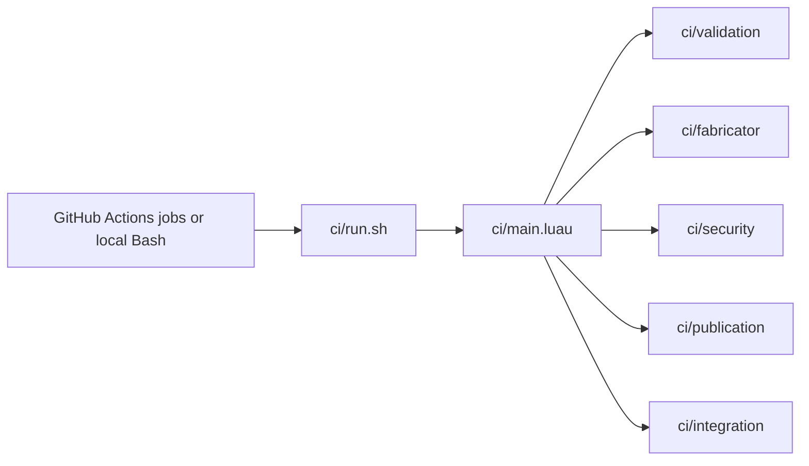

# CI responsibility and execution architecture

`.github/workflows/ci.yml` owns the hosted job graph, GitHub permissions, artifacts, concurrency, and publication gates. Its shell steps enter via `bash ci/run.sh <operation>`; `ci/main.luau` dispatches to an explicit Luau module, rather than executing arbitrary module paths.

A single command interface does **not** combine different GitHub jobs into one privileged process. Validation, build, evidence, and publication retain independent permission and trust boundaries. The `gate` required check remains the source-branch protection boundary.

## Allowed tooling

- `.github/actions/setup-lune/`, `setup-github/`, `setup-rust/`, `setup-cmake/` install optional execution environments as needed.
- `ci/fabricator/distribution/images/install.sh` is a Docker-internal installation helper, not a CI entry point.
- `ci/publication/repo/publish-internal.sh` is an internal Git transport invoked only after the dispatcher checks publication eligibility.
- `ci/integration/editor-bridge/` is a VS Code integration for the existing GitHub Local Actions extension, not a second CI runner.
- `ci/libraries/bootstrap/native.mjs` provides Node built-in crypto/number operations for Luau; no Rust build or npm packages are required for the CI helper.

Removed execution wrappers (`run-luau`, `setup-native`, `publication/pages/action.yml`, old publish scripts) are **not** supported entry points. The public CI command is `ci/run.sh`.

## Code ownership

`ci/integration/` owns GitHub APIs and controls; `ci/libraries/` owns reusable pure and host-facing modules; `ci/validation/` owns tests and repository shape; `ci/fabricator/` owns explicitly selected application builds; `ci/security/` owns authorization and receipts; `ci/publication/` owns publishing. Application `src/` declarations must never grant publication authority.

See the tracked [repository architecture contract](../../rules/contracts/repository/template-architecture.md) for the normative boundary.
