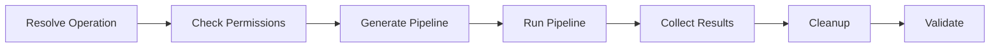
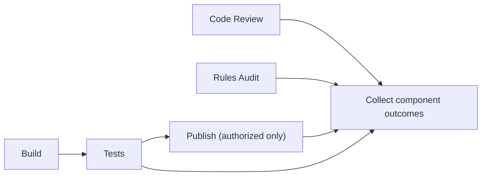

# RFC: Permanent CI as a linear execution controller

Status: **proposed; implementation not started**  
Base: `source`  
Scope: `Kooraseru/Template`

## Non-negotiable invariant

`.github/workflows/ci.yml` is one **permanent, linear executor**. Adding an operation, check, audit, component, dependency, credential requirement, publication target, or reporting rule **must not require modifying this YAML**.

The controller contains only generic jobs and generic dispatch commands. The *generated pipeline* is a different artifact: its graph is assembled dynamically from the operation, component contracts, execution policies, and credential capability requirements.

Do not merge a documentation-only PR as though this implementation is complete.

## Permanent workflow — jobs left to right

This is the only static job chain. Each box below is one full GitHub Actions job and owns its listed steps. *Run Pipeline is not Generate Pipeline.* Code Review, Rules Audit, Build, Tests and Publish are dynamic pipeline components, not permanent YAML jobs.

### 1. Resolve Operation

1. Checkout the triggering repository revision (without persisted checkout credentials).
2. Initialize Node.js/runtime toolchain.
3. Download/install managed dependencies needed for operation resolution.
4. Read and validate `.github/config/ci/operations.json`.
5. Read the GitHub event and manually supplied operation inputs.
6. Determine source ref, target ref, event identity and trust classification.
7. Select the configured operation; reject unknown or disallowed event/operation combinations.
8. Resolve operation options such as publication eligibility, plan type, branch policy and resource limits.
9. Read component declarations *as metadata*, without executing component source.
10. Validate operation configuration and produce a non-secret, typed operation manifest.
11. Upload/export that manifest and its digest for subsequent jobs.

### 2. Check Permissions

1. Checkout the trusted controller revision and load the operation manifest.
2. Initialize Node.js and install the managed authorization/validation dependencies.
3. Load `.github/config/credentials.json` and its schema.
4. Identify declared capabilities required by selected components and report writers.
5. Identify eligible GitHub environments and permission boundaries for each capability.
6. Resolve allowed providers (environment-backed GitHub App, verified token, OIDC broker or configurable adapter), under the operation's trust policy.
7. Confirm that configured bindings/source contracts can satisfy the request, including identifying required variables/secrets.
8. Validate environmental restrictions and static permissions, but **do not read arbitrary secret values or claim to have enumerated GitHub environment secrets**.
9. Record unresolved, unavailable, disallowed and authorized capability plans distinctly.
10. Produce a non-secret authorization manifest containing environment identities, capability requests and resolution strategy (not tokens).
11. Fail closed when a privileged plan is requested by untrusted PR code; otherwise export the authorization manifest.

*Important:* actual GitHub secrets are exposed only inside the relevant job's declared environment. A broker can exchange an OIDC token, but OIDC itself is identity, not a GitHub API credential. GitHub Actions cannot dynamically enumerate all secret values; source discovery is bounded by declared bindings or a broker/provider contract.

### 3. Generate Pipeline

1. Checkout the relevant, policy-approved source revision.
2. Initialize Node.js and download/install generator and validation dependencies.
3. Retrieve the operation and authorization manifests; check integrity/digests.
4. Discover enabled components from component contracts and `.github/config/ci/components.toml`.
5. Include Code Review, Rules Audit, Build, Tests, Publish and any future operation-specific components using the *same* component contract and discovery mechanism.
6. Load `.github/config/ci/execution.toml` and any component-level policy.
7. Resolve component inputs/outputs, task ordering, dependencies and failure/skip semantics.
8. Reject missing dependencies, dependency cycles, invalid privilege transitions and unauthorized events.
9. Construct the generated component DAG, including per-job permissions and environment assignments.
10. Keep untrusted PR execution read-only; deny privilege escalation through PR-controlled metadata.
11. Render the generated pipeline workflow(s), keeping permission/environment binding local to authorized jobs.
12. Lock action dependencies and perform schema/actionlint and manifest/graph validation.
13. Export the immutable generated plan, workflow bundle, provenance and digest.
14. Upload the bundle as an artifact; **do not launch it here**.

### 4. Run Pipeline

1. Checkout the trusted controller and initialize Node.js.
2. Install managed launcher/monitoring dependencies.
3. Download generated pipeline artifact and verify its digest/source identity.
4. Load authorization plan and choose execution transport based on trust.
5. For untrusted PRs, run a segregated, credential-free pipeline executor and report its full conclusion; do not push PR-authored generated workflow code via privileged credentials.
6. For trusted execution, acquire the *bootstrap-only* branch-launch capability in a permitted environment (or broker), without making it available to component jobs.
7. Stage and launch the generated workflow using an owned temporary ref; do not update `source`.
8. Locate the expected run by repository, branch, revision and workflow identity.
9. Monitor dispatch/startup and await **completion**, not just scheduling.
10. Propagate cancellation, timeout, startup failure and component failures.
11. Export run identifiers, conclusion, job status and execution artifact references; keep temporary resources available until cleanup.
12. Never serialize credentials into generated branches, logs, job outputs or artifacts.

### 5. Collect Results

1. Checkout the controller revision and initialize the reporting runtime.
2. Install managed artifact/reporting dependencies.
3. Read run identifiers and final execution status from Run Pipeline.
4. Retrieve component diagnostics, logs, build outputs and response fragments.
5. Verify artifact identities and handle missing, partial or timed-out results.
6. Normalize results into one component outcome contract: `passed`, `failed`, `skipped`, `cancelled` and `blocked` with explicit evidence.
7. Apply configured skip and reporting policies, preserving raw results and never laundering a failure as success.
8. Produce consolidated machine-readable findings and human-readable response.
9. If neutral GitHub Check Run reporting is configured, perform it in its own authorized reporting environment using the correct scoped GitHub App; do not rely on silent secret inheritance through reusable workflows.
10. Treat reporting unavailability as a *reporting* outcome, distinct from original execution status; apply the declared policy.
11. Upload final response and related artifacts even when the execution failed.

### 6. Cleanup

1. Checkout controller code and initialize cleanup dependencies.
2. Read owned temporary resource manifest/run identity, even when prior jobs failed.
3. Check resource ownership, ref, expected SHA and operation namespace before deletion.
4. Remove owned generated execution branches where safe.
5. Remove temporary worktrees, transient files and other owned resources.
6. Revoke ephemeral credentials where supported; otherwise rely on short lifetimes and report an explicit revocation outcome.
7. Preserve failure evidence and logs when cleanup encounters an error.
8. Export cleanup result without overwriting the prior pipeline result.

### 7. Validate

1. Read the upstream job results via `needs`, plus operation/authorization/generation/launch/collection/cleanup outcome manifests.
2. Verify operation resolution succeeded and the event was authorized.
3. Verify permission planning and any required approvals completed.
4. Verify pipeline generation was valid and the launched artifact matched the generated digest.
5. Require completed pipeline execution or a strictly documented skip/deny outcome; dispatch is not success.
6. Verify component conclusions, required artifacts and declared skip policy.
7. Verify collection/reporting status independently of component execution status.
8. Verify cleanup result and identify leaked owned resources as appropriate.
9. Preserve the original failure reason, with priority given to security/authorization/launch failures; do not mask it with later cleanup/reporting errors.
10. Set the final, stable required `validate` check result.

## Strict chain and failure semantics

GitHub jobs are separate runners; managed dependencies need reinstalling, verified cache restoration or explicit artifact transport in each job that uses them. The straight-line graph does **not** mean failing upstream jobs may silently skip the final stages. Collect Results, Cleanup and Validate require failure-aware conditional execution (for example `always()` with guarded inputs). Generate and Run must not execute an invalid plan.

Any conditional route remains inside the job's generic executable. The workflow YAML must not grow separate `review`, `rules-audit`, `build`, `test`, or `publish` jobs.

## Generated pipeline and permission boundary

The generated pipeline's DAG can branch and run tasks concurrently. A suggested logical flow is:

These are *illustrative components*, not fixed pipeline requirements. Operation metadata chooses the actual graph.

The existing GitHub App/OIDC selector and credential catalog should be adapted, not replaced with a hardcoded list of token names. Capability-based selection is permitted only among credentials made available through an explicitly configured trusted source. Any dynamic workflow jobs requiring environment credentials must acquire them in the right environment; nested reusable workflows must not assume access to caller environment secrets.

Security invariant: untrusted PR-controlled code may never run in an environment that carries workflow-write, publication, administration, or credential-broker privileges. Generated workflow startup from a trusted ref must not become a path for untrusted code injection.

## Proposed migration sequence

1. Add typed manifests and contract tests for the seven permanent job interfaces.
2. Implement generic operation resolution, replacing the fixed review/audit check-group split.
3. Create permission-planning and credential-source discovery with environment and OIDC integration; add missing-key and secret-forwarding regression tests.
4. Migrate Code Review and Rules Audit into discoverable pipeline components.
5. Split generated workflow compilation from remote/local pipeline execution.
6. Normalize component report collection, check reporting and failure/skip propagation.
7. Implement owned resource cleanup and a final aggregate `validate` gate.
8. Replace the permanent `ci.yml` *once* with the minimal seven-job chain.
9. Verify untrusted PR isolation, local `act`, hosted PR checks, full graph execution, missing credentials, denied permissions, cancellations, partial failures and resource cleanup.
10. Exercise privileged publication only in an explicitly safe trusted test before marking the PR ready.

## Acceptance criteria

- [ ] Exactly one permanent authored workflow `.github/workflows/ci.yml`, with seven jobs in a static straight line.
- [ ] Adding an operation or component requires **zero** changes to the permanent YAML.
- [ ] Independent Code Review and Rules Audit inside dynamically chosen pipeline graph.
- [ ] Credential role/environment resolution without hardcoding token names into operations.
- [ ] Environment/OIDC strategies share a common capability-resolution contract; no false claim of arbitrary GitHub secret enumeration.
- [ ] Generate Pipeline and Run Pipeline are separate, auditable jobs.
- [ ] A successful dispatch alone can never pass `validate`.
- [ ] Untrusted PR code cannot access or indirectly execute with privileged credentials.
- [ ] Reporting and cleanup failures remain visible and do not overwrite original component outcomes.
- [ ] Local and hosted validation pass on the current revision; publication tested via a safe trusted route.
- [ ] No changes to `source` until this PR is reviewed and merged.

## Explicitly deferred

Do not use this proposal-only commit to claim the pipeline migration is implemented, or that the current live publication failure is fixed.
